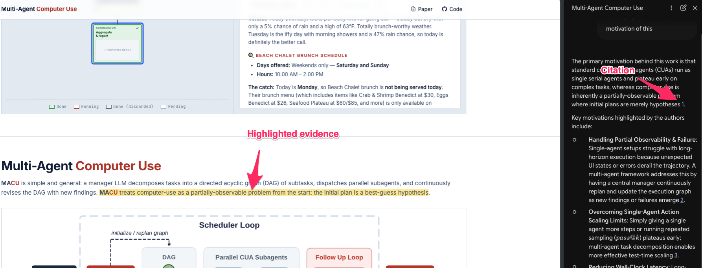
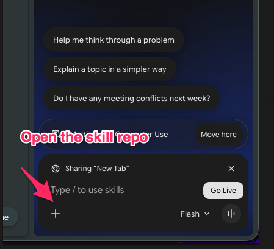
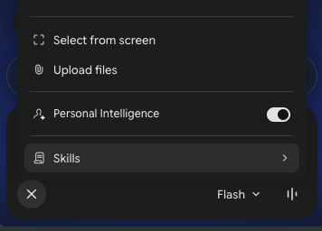
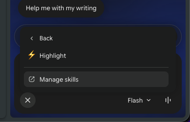
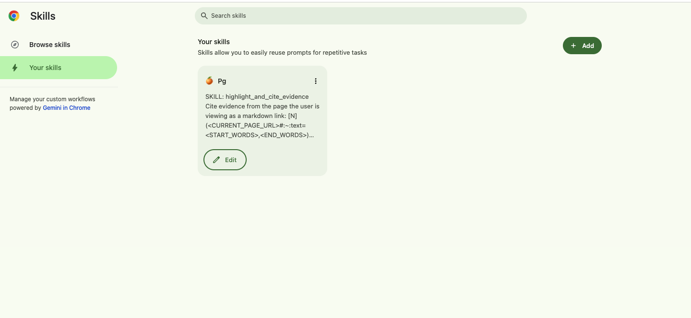
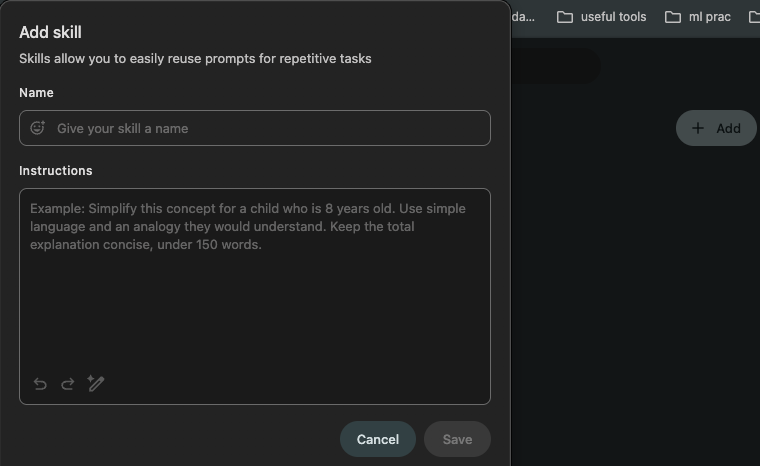
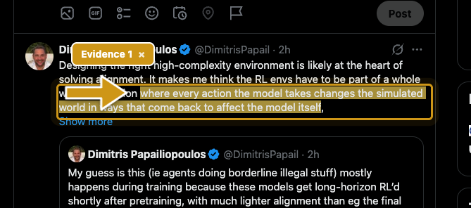
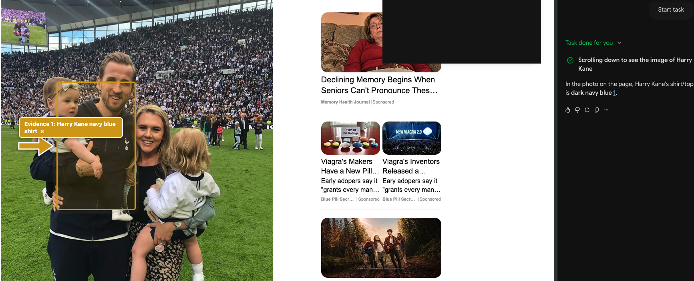
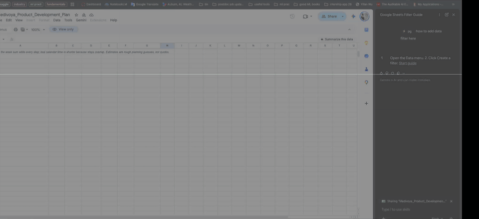

  

<h1 align="center">PageGuide Gemini</h1>

<strong><a href="https://pageguide.github.io">Visit the PageGuide website</a></strong>

A Chrome extension for Gemini in Chrome. When you click a citation link in a Gemini answer, it switches to the tab you already have open for that page instead of opening a duplicate, then scrolls to and highlights the cited text.

Click a citation in the Gemini panel (right) and the evidence is highlighted on the page (left).

## Install the extension

1. Clone or download this repo.
2. Open `chrome://extensions` and turn on **Developer mode**.
3. Click **Load unpacked** and select this folder.
4. Reload any tabs you want highlighted, including the Gemini tab.

## Add the skill to Gemini

Gemini needs to format its citations in a way the extension can read. The format is in [`GEMINI_SKILL.md`](GEMINI_SKILL.md).

1. Open Gemini in Chrome and click the **+** button in the prompt box.

   

2. Click **Skills**.

   

3. Click **Manage skills**.

   

4. On the **Your skills** page, click **Add**.

   

5. In the **Add skill** form, enter `pg` as the **Name**, paste the contents of `GEMINI_SKILL.md` into **Instructions**, and click **Save**. This **Name** field controls the skill command.

   

6. When you ask a question about a page, click **+**, then **Skills**, then **pg**, or type `/pg` in the prompt box.

## Use it

1. Open the page or paper you want to read (for example an arXiv paper) in a tab.
2. Share that tab with Gemini and ask a question with the skill enabled.
3. Click a citation like `[1]` in the answer.
4. The extension jumps to your open tab and highlights the quoted text.

## Visual evidence

For things that aren't text (an object in a photo, a spot on a map, a region of a chart), the skill makes Gemini give a box instead of a quote. The extension finds the image, map, or canvas on the page, scrolls to it, and draws the box, arrow, and a short label over it. This works best for images and charts. On maps and canvases the box is only right if you haven't panned or zoomed since Gemini looked.

## What it can do

| Ability | What you get | Works on | Needs in Gemini's answer |
| --- | --- | --- | --- |
| Jump to the open tab | Switches to the tab you already have instead of opening a duplicate | Any `http(s)` page, Google Docs/Sheets/Slides | Any citation link |
| Text evidence | Scrolls to and highlights the cited quote, with an arrow and "Evidence N" sign | Webpages, shadow-DOM pages, Google Docs/Slides (readable view) | `#:~:text=` link |
| PDF evidence | Chrome highlights the quote in the already-open PDF tab | PDFs, arXiv PDFs | `#:~:text=` link |
| Google Sheets cells | Highlights an exact cell by A1 address and checks its value | Google Sheets (readable view) | `#pg-cell=` link |
| Visual evidence | Draws a labelled box and arrow on an image, chart, map, canvas or video frame | Pages with images, maps, charts | `#pg-box=` link |
| Step-by-step guide | Walks through up to 12 UI controls with arrows, a step card, Previous/Next and click-to-advance | Live web apps, such as the Google Sheets editor | `#pg-guide=` link |
| Fails safely | Shows a notice or the plain instruction instead of pointing at a wrong spot | All of the above | n/a |

## Use cases

### 1. Find evidence on the page you are reading

Ask Gemini a question about the page you have open. Each statement in its answer ends with a numbered citation. Click it and the extension scrolls to the exact text, highlights it, and points an arrow at it with an "Evidence N" sign. It works on long posts and articles, and on pages built with shadow DOM, such as social feeds. Here, a citation on an X post jumps to the sentence it came from.

### 2. Navigate, then draw on an image

Give Gemini a browsing task, such as "scroll down and find the photo of Harry Kane and tell me what he is wearing". Gemini navigates to the picture, and its answer cites what it saw with a box. Click the citation and the extension draws a bounding box, an arrow, and a short label directly on the image. This also works for maps, charts, and video frames, not only text.

### 3. Get a step-by-step guide

Ask Gemini how to do something in the app you have open, such as "how do I add a filter in Google Sheets?". It answers with the steps and a **Start guide** link. Click it and PageGuide walks you through the task on the live page: a box and arrow point at the Data menu, then at **Create a filter**, with a **Step N of M** card and **Previous** / **Next** controls.

## Notes

- **Webpages:** the extension highlights the quote itself; clicking another citation replaces the previous highlight. It also draws a pulsing box, a bobbing arrow and an "Evidence N" sign on the quote, which fade out after a few seconds.
- **Google Docs, Sheets, and Slides:** these editors draw content on canvases instead of exposing normal webpage text. PageGuide keeps the same tab but switches it to Google's text-readable view so it can highlight the cited words. Click **← Back to editor** to return to normal editing.
- **PDFs:** Chrome's PDF viewer blocks extension scripts, so Chrome highlights the quote itself. Each click opens the PDF fresh and closes the old tab, so only the latest quote is highlighted.
- If a quote isn't highlighted, the words in the citation probably don't match the page text exactly. Pages where text is drawn as an image can't be highlighted.

## Step-by-step guides

Ask Gemini how to do something in the app you have open, such as "how do I add a filter in Google Sheets?". With the skill enabled, it answers with a **Start guide** link. Click it and PageGuide switches to your open tab (the live editor, not a read-only view) and walks you through the task one control at a time:

- a pulsing box, bobbing arrow and **Step N of M** sign point at the exact menu, button or option to use;
- a card shows the instruction with **Previous** and **Next** controls (**Done** on the last step) and a close button;
- the overlay never blocks clicks. You do the action yourself, and clicking the highlighted control moves to the next step once the page reacts (for example when a menu opens);
- if a control can't be found on screen, PageGuide doesn't guess. It shows the instruction and leaves the arrow off, and you can continue with **Next**.

The link format, `#pg-guide=1&step=<UI label>~<instruction>`, is described in [`GEMINI_SKILL.md`](GEMINI_SKILL.md). Controls are matched by their visible text, tooltip or `aria-label`, so the label Gemini gives must match what the page shows. Evidence citations (text, Sheets cells, image boxes) are unchanged.

## Author

Made by [Tin Nguyen](https://github.com/tinxai). It builds on ideas from [PageGuide](https://github.com/tinxai/pageguide).

## License

[MIT](LICENSE) © 2026 Tin Nguyen
