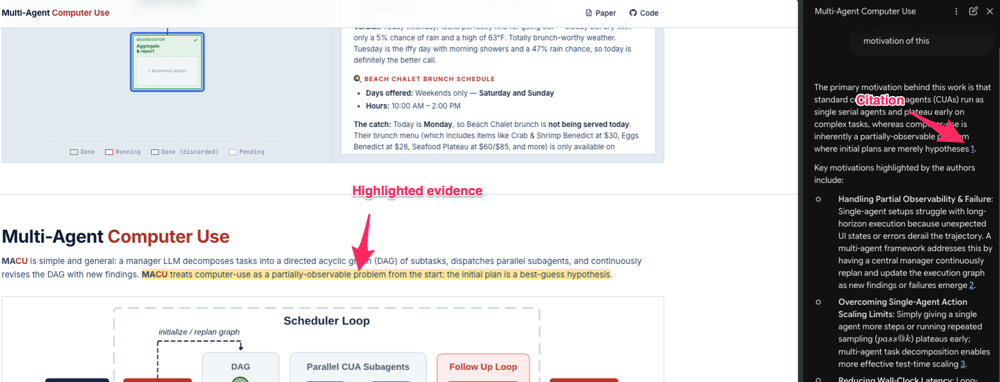
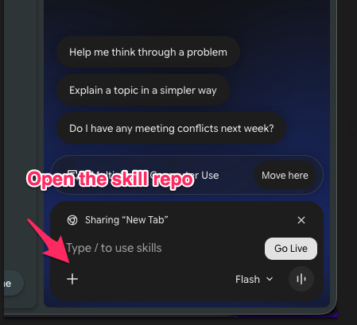
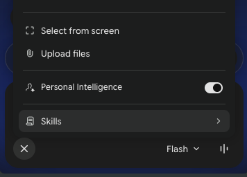
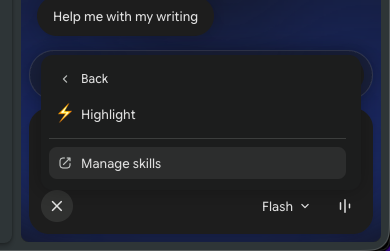
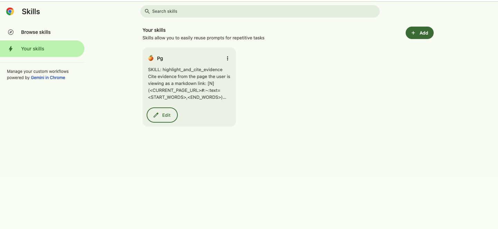
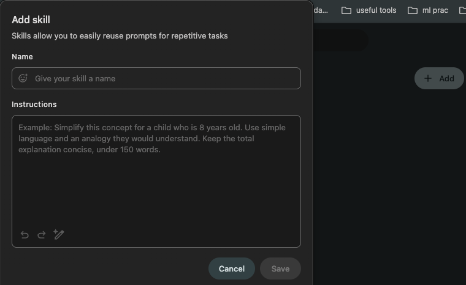

  

<h1 align="center">PageGuide Gemini</h1>

A Chrome extension for Gemini in Chrome. When you click a citation link in a Gemini answer, it switches to the tab you already have open for that page instead of opening a duplicate, then scrolls to and highlights the cited text.

Click a citation in the Gemini panel (right) and the evidence is highlighted on the page (left).

## Install the extension

1. Clone or download this repo.
2. Open `chrome://extensions` and turn on **Developer mode**.
3. Click **Load unpacked** and select this folder.
4. Reload any tabs you want highlighted, including the Gemini tab.

## Add the skill to Gemini

Gemini needs to format its citations in a way the extension can read. The format is in [`GEMINI_SKILL.md`](GEMINI_SKILL.md).

1. Open Gemini in Chrome and click the **+** button in the prompt box.

   

2. Click **Skills**.

   

3. Click **Manage skills**.

   

4. On the **Your skills** page, click **Add**.

   

5. In the **Add skill** form, enter `Highlight` as the **Name**, paste the contents of `GEMINI_SKILL.md` into **Instructions**, and click **Save**.

   

6. When you ask a question about a page, click **+**, then **Skills**, then **Highlight** (or type `/` in the prompt box) to use the skill.

## Use it

1. Open the page or paper you want to read (for example an arXiv paper) in a tab.
2. Share that tab with Gemini and ask a question with the skill enabled.
3. Click a citation like `[1]` in the answer.
4. The extension jumps to your open tab and highlights the quoted text.

## Visual evidence

For things that aren't text (an object in a photo, a spot on a map, a region of a chart), the skill makes Gemini give a box instead of a quote. The extension finds the image, map, or canvas on the page, scrolls to it, and draws the box, arrow, and a short label over it. This works best for images and charts. On maps and canvases the box is only right if you haven't panned or zoomed since Gemini looked.

## Notes

- **Webpages:** the extension highlights the quote itself; clicking another citation replaces the previous highlight. It also draws a pulsing box, a bobbing arrow and an "Evidence N" sign on the quote, which fade out after a few seconds.
- **PDFs:** Chrome's PDF viewer blocks extension scripts, so Chrome highlights the quote itself. Each click opens the PDF fresh and closes the old tab, so only the latest quote is highlighted.
- If a quote isn't highlighted, the words in the citation probably don't match the page text exactly. Pages where text is drawn as an image can't be highlighted.

## Author

Made by [Tin Nguyen](https://github.com/tinxai). It builds on ideas from [PageGuide](https://github.com/tinxai/pageguide).

## License

[MIT](LICENSE) © 2026 Tin Nguyen
